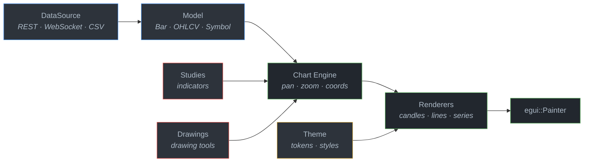

<div align="center">

# egui-charts

**Financial charting engine for [egui](https://github.com/emilk/egui).**

[](https://github.com/userFRM/egui-charts/actions)
[](https://crates.io/crates/egui-charts)
[](https://docs.rs/egui-charts)
[](#license)
[](#minimum-supported-rust-version)

[Live Demo](https://userfrm.github.io/egui-charts/demo/) · [API Docs](https://docs.rs/egui-charts) · [Examples](https://github.com/userFRM/egui-charts/tree/main/examples)

<!--  -->

</div>

---

Candlestick, bar, line, area, Japanese and range chart types, drawing tools, technical indicators and a design-token theme system. Pure Rust: compiles to native targets and WebAssembly with no JavaScript dependencies.

---

## When This Is Useful

- **You need financial charts inside an egui application:** candlesticks, OHLC bars, Heikin-Ashi, Renko, Kagi, Market Profile (TPO) and other chart types.
- **You're building a Tauri desktop trading terminal:** the chart is an egui widget, with optional toolbar, panel and dialog UI behind the `ui` feature.
- **You want interactive drawings and indicators:** drawing tools with undo/redo, and indicators behind one `Indicator` trait.
- **You need a themeable design system:** one `Theme` value with dark, light and high-contrast presets and public fields to override.
- **You want one codebase for desktop and web:** the same `Chart` widget renders natively on Linux/macOS/Windows and in the browser via WebAssembly.

---

## Architecture



<details>
<summary><strong>Module map</strong></summary>

```text
egui-charts/src/
├── chart/                     Rendering engine, pan/zoom, hit-testing, overlays
│   ├── builder.rs             ChartBuilder fluent API + TradingChart runtime wrapper
│   ├── rendering/             Per-chart-type rendering (candles, lines, areas, Renko, Kagi, TPO…)
│   ├── renderers/             Crosshair, indicator lines, labels, markers, session breaks
│   ├── coords/                Coordinate mapping (chart ↔ screen space)
│   ├── pan_zoom.rs            Pan/zoom with kinetic scrolling
│   └── indicators/            Indicator hit testing and selection rendering
├── drawings/                  Drawing tools: creation, selection, handles, undo/redo
│   ├── domain/                Pure types: DrawingToolType, Drawing, ChartPoint, options
│   ├── services/              Selection, undo/redo (command pattern), snapping, z-ordering
│   ├── rendering/             Category-specific renderers (lines, fibonacci, patterns…)
│   └── persistence.rs         Serializable drawing types (not yet wired to save/load)
├── studies/                   Technical indicators
│   ├── builtin/               All indicator implementations
│   ├── factory.rs             IndicatorFactory: dynamic creation by name
│   ├── indicator_trait.rs     Core Indicator trait and IndicatorValue enum
│   └── custom.rs              Runtime indicator creation with closures
├── model/                     Domain types: Bar, BarData, Symbol, Timeframe, ChartType
├── scales/                    Price scales (linear, log, %), time scales, formatters
├── config/                    ChartConfig, ChartOptions, crosshair, tooltip, keyboard
├── data.rs                    DataSource trait: pluggable data provider interface
├── validation/                OHLC integrity checks, timestamp ordering
├── theme/                     Theme value, its presets, apply_to_egui
├── tokens/                    Design tokens as Rust constants (colors, spacing, typography)
├── styles/                    Focus ring, sizing, typography and icon constants
├── widget/                    Chart egui widget, indicator panes
├── icons/                     Compile-time embedded SVG icons
├── ext/                       UiExt, ResponseExt, widget builder extensions
├── ui/          [feature: ui] Toolbars, panels, dialogs, replay controls
└── ui_kit/      [feature: ui] Reusable widget library: buttons, forms, color pickers
```

</details>

---

## Quick Start

Add the dependency:

```toml
[dependencies]
egui-charts = "0.2"
```

Create a chart in your egui app (this example uses `eframe`):

```rust
use egui_charts::{ChartBuilder, TradingChart};
use egui_charts::model::Timeframe;
use egui_charts::theme::Theme;

struct App {
    chart: TradingChart,
}

impl eframe::App for App {
    fn ui(&mut self, ui: &mut egui::Ui, _frame: &mut eframe::Frame) {
        egui::CentralPanel::default().show(ui, |ui| {
            self.chart.update(); // poll the data source, load older bars
            self.chart.show(ui); // render the chart
        });
    }
}

// Build a chart with the fluent API
let chart = ChartBuilder::new()
    .with_symbol("BTCUSDT")
    .with_timeframe(Timeframe::Hour1)
    .with_theme(Theme::dark())
    .with_drawing_tools()
    .build();
let app = App { chart };
```

For a minimal price sparkline (no grid, no crosshair, no tools):

```rust
# use egui_charts::ChartBuilder;
let mini = ChartBuilder::price_chart()
    .with_symbol("ETHUSDT")
    .with_visible_candles(30)
    .build();
```

---

## Builder Presets

| Constructor | Use Case |
|---|---|
| `ChartBuilder::new()` | Sensible defaults, auto-fetch 1000 bars |
| `ChartBuilder::extended()` | Full trading terminal with drawings + indicators |
| `ChartBuilder::price_chart()` | Minimal sparkline / dashboard widget |
| `ChartBuilder::options_chart()` | Non-time-based displays (options chains) |

---

## Feature Flags

| Feature | Default | Description |
|---|:---:|---|
| `widget` | **on** | The egui chart widget and the modules built on it: `chart`, `drawings`, `config`, `theme`, `styles`, `ext` and `widget`. Without it the crate is the headless engine (`model`, `scales`, `data`, `studies`, `tokens`, `validation`), which does not depend on egui. Required by `icons` and `ui`. |
| `icons` | **on** | Compile-time embedded SVG icons, drawn through egui_extras' SVG image loader, which the chart installs in the egui context. Required by `ui`. Use `default-features = false, features = ["widget"]` to drop egui_extras and save binary size. |
| `ui` | off | Application-level UI: drawing toolbar, top toolbar, timeframe bar, replay controls, sidebars, dialogs, and the `ui_kit` widget library. |

```toml
# Core chart only (default)
egui-charts = "0.2"

# Full trading terminal UI
egui-charts = { version = "0.2", features = ["ui"] }

# Headless engine: bars and studies without egui
egui-charts = { version = "0.2", default-features = false }
```

egui-charts does not enable egui's default features, so fonts are the application's choice (eframe enables egui's `default_fonts` by default). The chart installs no image loader other than SVG; an application that shows PNG, JPEG, file or HTTP images calls `egui_extras::install_image_loaders` with the loader features it needs.

---

## Chart Types

Chart types in six categories:

| Category | Types |
|---|---|
| **Standard** | Candlesticks · OHLC Bars · Hollow Candles · Volume Candles |
| **Line** | Line · Line with Markers · Step Line |
| **Area** | Area · HLC Area · Baseline |
| **Japanese** | Heikin-Ashi · Renko · Kagi · Line Break · Point & Figure |
| **Range** | High-Low · Range Bars |
| **Advanced** | TPO / Market Profile |

---

## Drawing Tools

`DrawingToolType` defines 95 drawing tool types, counting four cursor modes. Paintbrush draws the same as Brush, and the Font Icon tool is not reachable from the toolbar yet. The drawing toolbar groups the tools into eight categories:

| Category | Examples |
|---|---|
| **Cursors** | Cross, Dot, Arrow, Eraser |
| **Lines** | Trend Line, Ray, Horizontal/Vertical, Channels, Pitchforks |
| **Fibonacci** | Retracement, Extension, Channel, Time Zones, Circles, Spiral, Wedge |
| **Patterns** | XABCD, Cypher, Head & Shoulders, Elliott Waves, Cycles |
| **Projection** | Long/Short Position, Forecast, Anchored VWAP, Volume Profile |
| **Shapes** | Brush, Highlighter, Rectangle, Circle, Ellipse, Polyline, Arc |
| **Annotations** | Text, Note, Callout, Comment, Price Label, Signpost, Table, Image |
| **Icons** | Font Icon / Emoji |

Drawings are anchored in chart coordinates (bar index and price), so they stay in place through pan and zoom. Undo/redo is built in. Some tools are placeholders or approximations; [ROADMAP.md](ROADMAP.md) lists the status of each. Magnet snapping is not applied yet, and drawings cannot yet be saved and restored: the serializable types in `drawings::persistence` do not restore chart coordinates.

---

## Technical Indicators

`IndicatorFactory` registers 128 indicator names, each creating a type that implements the `Indicator` trait. Some names compute the same values as another under their default settings, for example HL2 and Median Price, HLC3 and Typical Price, or A/D and CVD. The indicator dialog in the `ui` feature offers a fixed subset.

| Category | Indicators |
|---|---|
| **Moving Averages** | SMA, EMA, WMA, DEMA, TEMA, HMA, ALMA, VWMA, LSMA, SWMA, KAMA, VIDYA, McGinley Dynamic, and more |
| **Momentum** | RSI, MACD, Stochastic, Williams %R, CCI, ROC, Momentum, Aroon, Awesome Oscillator, Ultimate Oscillator, Connors RSI, TRIX, KDJ |
| **Trend** | ADX, SuperTrend, Ichimoku Cloud, Parabolic SAR, Directional Movement, Vortex, Squeeze Momentum |
| **Volatility** | Bollinger Bands, ATR, Keltner Channels, Donchian Channels, Historical Volatility, Chandelier Exit |
| **Volume** | OBV, VWAP, MFI, A/D, CMF, Volume ROC, Klinger Oscillator, CVD, Volume Profile |
| **Support** | Pivot Points, ZigZag, Price Channel |
| **Statistics** | Correlation, Linear Regression, Standard Error, Rank Correlation |

```rust
use egui_charts::studies::{Indicator, IndicatorRegistry, SMA, RSI, BollingerBands};

let mut registry = IndicatorRegistry::new();
# let bars: Vec<egui_charts::model::Bar> = Vec::new();
registry.add(Box::new(SMA::new(20)));
registry.add(Box::new(RSI::new(14)));
registry.add(Box::new(BollingerBands::new(20, 2.0)));
registry.calculate_all(&bars);
```

---

## Custom Data Sources

Implement `DataSource` to connect any market data provider:

```rust
use egui_charts::data::{DataSource, DataSourceError, DataUpdate, HistoricalDataRequest};
use egui_charts::model::{Bar, Timeframe};

struct MyBrokerData {
    subscriptions: Vec<(String, Timeframe)>,
}

impl DataSource for MyBrokerData {
    fn symbols(&self) -> Vec<String> {
        vec!["BTCUSDT".to_string()]
    }

    fn subscribe(&mut self, symbol: String, timeframe: Timeframe) -> Result<(), DataSourceError> {
        self.subscriptions.push((symbol, timeframe));
        Ok(())
    }

    fn unsubscribe(&mut self, symbol: String) -> Result<(), DataSourceError> {
        self.subscriptions.retain(|(s, _)| *s != symbol);
        Ok(())
    }

    fn poll(&mut self) -> Vec<DataUpdate> {
        // Return the updates your feed delivered since the last call.
        Vec::new()
    }

    fn fetch_historical(
        &mut self,
        request: HistoricalDataRequest,
    ) -> Result<Vec<Bar>, DataSourceError> {
        // Load up to `request.limit` bars before `request.end_ts_millis`
        // from your API, database or files.
        Ok(Vec::new())
    }

    fn get_timeframe(&self, symbol: &str) -> Option<Timeframe> {
        self.subscriptions.iter().find(|(s, _)| s == symbol).map(|(_, tf)| *tf)
    }
}
```

`TradingChart` calls `poll` and `fetch_historical` on the UI thread, so both should return quickly. Run network I/O on another thread and hand the results to the data source through a channel.

---

## Theme System

A `Theme` is one value: UI colours (`theme.ui`), chart colours (`theme.chart`), and the type, spacing and corner radius scales (`theme.text`, `theme.spacing`, `theme.radius`). All fields are public.

| Preset | UI chrome | Chart |
|---|---|---|
| `Theme::dark()` (default) | Dark | Dark |
| `Theme::light()` | Light | Light |
| `Theme::high_contrast()` | Black, text except disabled text at 7:1 or better | Black |

Start from a preset, override what you need, and apply it once at startup and again after every change:

```rust
use egui::Color32;
use egui_charts::theme::{Theme, apply_to_egui};

# let ctx = &egui::Context::default();
// The accent's hover and pressed shades, the text on it and the selection follow it.
let mut theme = Theme::dark().with_accent(Color32::from_rgb(255, 120, 0));
theme.chart.candle_up = Color32::from_rgb(0, 160, 120);
theme.chart.candle_down = Color32::from_rgb(220, 60, 60);
apply_to_egui(ctx, &theme);

// Light UI chrome with the dark chart.
let classic = Theme { chart: Theme::dark().chart, ..Theme::light() };
```

With the `serde` feature, `Theme` implements `Serialize` and `Deserialize`, so a theme can be stored in any serde format; fields missing from the input take the dark theme's values.

Inside a widget, `ui.active_theme()` (trait `theme::ThemeExt`) returns the theme last applied, or the dark theme if none was; colours egui models, such as the panel fill or the hover fill, are read from `ui.visuals()`, which `apply_to_egui` sets from the same theme.

---

## Tauri Integration

`egui-charts` is designed as the rendering engine for [Tauri](https://tauri.app) desktop applications.

```toml
[dependencies]
egui-charts = { version = "0.2", features = ["ui"] }
```

```rust
# struct App { chart: egui_charts::TradingChart }
use egui_charts::theme::{Theme, apply_to_egui};

impl eframe::App for App {
    fn ui(&mut self, ui: &mut egui::Ui, _frame: &mut eframe::Frame) {
        let theme = Theme::dark();
        apply_to_egui(ui.ctx(), &theme);
        // The root Ui was created before the theme was applied this frame.
        ui.set_style(ui.ctx().global_style());

        egui::CentralPanel::default().show(ui, |ui| {
            self.chart.update();
            self.chart.show(ui);
        });
    }
}
```

1. **Add the dependency** with the `ui` feature for toolbar and panel support.
2. **Implement `DataSource`** to bridge your Tauri backend (IPC or WebSocket) to the chart's data layer.
3. **Build the chart once** with `ChartBuilder`, then call `update()` and `show(ui)` in `eframe::App::ui`.
4. **Apply a theme** at startup with `apply_to_egui()` to propagate design tokens.

---

## Interaction

| Input | Behavior |
|---|---|
| Click + drag | Pan the chart |
| Scroll wheel / pinch | Zoom in and out |
| Zoom mode (`Chart::set_zoom_mode`) + drag | Box zoom |
| Crosshair | Can follow another chart via `Chart::set_synced_crosshair_bar_idx` |
| Keyboard | Configurable via `KeyboardOptions` |

Kinetic scrolling with momentum-based panning. Real-time streaming via `chart.update_data()` with auto-scroll.

---

## Platform Support

| Target | Status |
|---|---|
| Linux (x86_64, aarch64) | Supported |
| macOS (x86_64, aarch64) | Supported |
| Windows (x86_64) | Supported |
| WebAssembly (wasm32) | Supported (`wasm-bindgen` + `web-sys`) |

---

## Minimum Supported Rust Version

The MSRV is **1.95** (Rust edition 2024), enforced in `Cargo.toml` via `rust-version`.

---

## License

Licensed under either of

- [Apache License, Version 2.0](LICENSE-APACHE)
- [MIT License](LICENSE-MIT)

at your option.

Some interface icons under `assets/icons/` come from Lucide and are licensed under the ISC License (with a Feather-derived subset under the MIT License); see the [third-party notices](THIRD-PARTY-NOTICES.md) and the [Lucide licence](assets/icons/LICENSE-lucide.txt).

## Contributing

Contributions are welcome and the project is actively evolving: bug fixes, docs, examples, and creative additions like new indicators, drawing tools, chart types, and themes are all encouraged. Start with [CONTRIBUTING.md](CONTRIBUTING.md), which covers the dev setup, the project layout, where each kind of addition lives, and the local checks that mirror CI.

Please also read the [Code of Conduct](CODE_OF_CONDUCT.md), and report security issues privately per the [Security Policy](SECURITY.md). Questions and ideas are welcome in [Discussions](https://github.com/userFRM/egui-charts/discussions).

Unless you explicitly state otherwise, any contribution intentionally submitted for inclusion in the work by you, as defined in the Apache-2.0 license, shall be dual licensed as above, without any additional terms or conditions.
