<div align="center">

<picture>
  <source media="(prefers-color-scheme: dark)" srcset="docs/images/logo-dark.svg">
  
</picture>

Financial charts for Rust applications built with egui 0.37.

<p>
  <a href="https://userfrm.github.io/egui-charts/demo/"></a>
  <a href="https://userfrm.github.io/egui-charts/docs/"></a>
  <a href="https://docs.rs/egui-charts"></a>
  <a href="https://crates.io/crates/egui-charts"></a>
  <a href="https://github.com/userFRM/egui-charts/actions/workflows/ci.yml"></a>
  <a href="https://github.com/emilk/egui"></a>
  <a href="Cargo.toml"></a>
  <a href="#license"></a>
  <a href="examples"></a>
</p>

</div>

<picture>
  <source media="(prefers-color-scheme: light)" srcset="docs/images/hero-light.webp">
  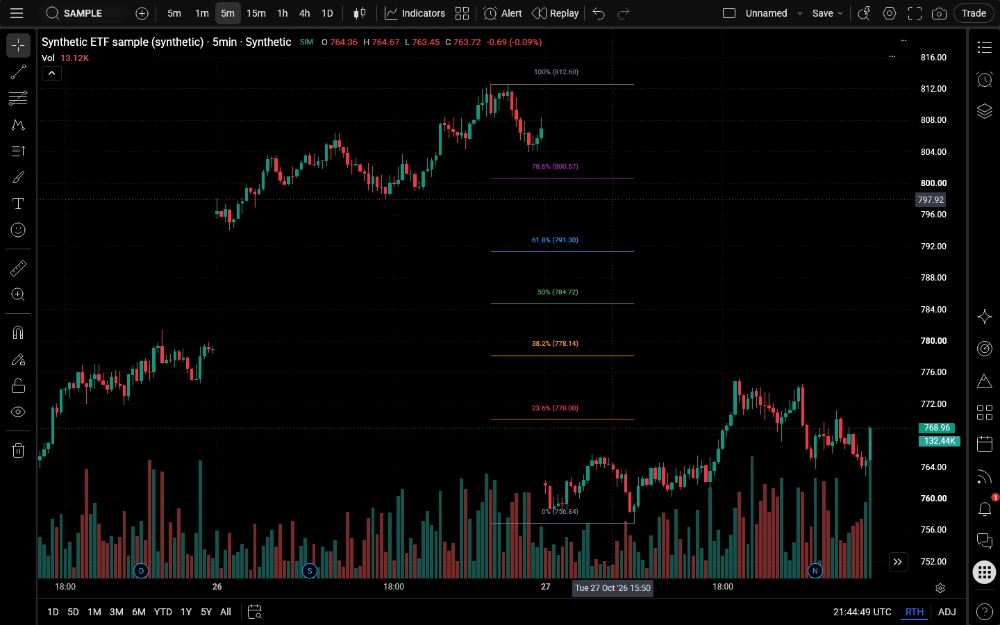
</picture>

*An intraday session: analysis, risk and orders on the same chart. Every image uses generated sample data and simulated trading.*

## Inside the demo

<table>
  <tr>
    <td width="50%" valign="top">
      <strong>Liquidity and executions</strong><br>
      <a href="docs/images/liquidity-dark.webp"><picture>
        <source media="(prefers-color-scheme: light)" srcset="docs/images/liquidity-light.webp">
        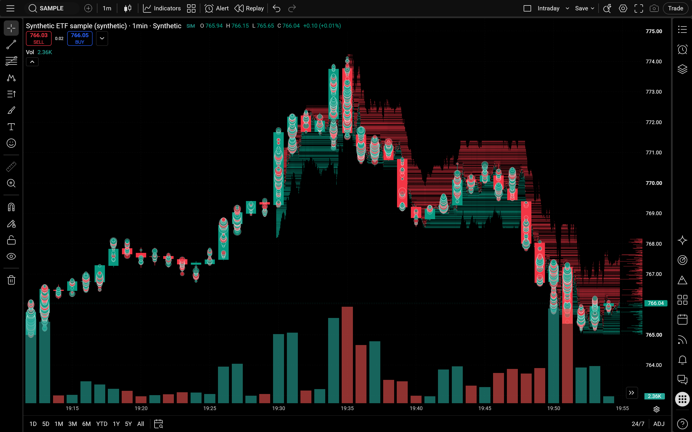
      </picture></a><br>
      Depth history and volume bubbles from the sample feed’s synthetic order book.
    </td>
    <td width="50%" valign="top">
      <strong>Session volume</strong><br>
      <a href="docs/images/profile-dark.webp"><picture>
        <source media="(prefers-color-scheme: light)" srcset="docs/images/profile-light.webp">
        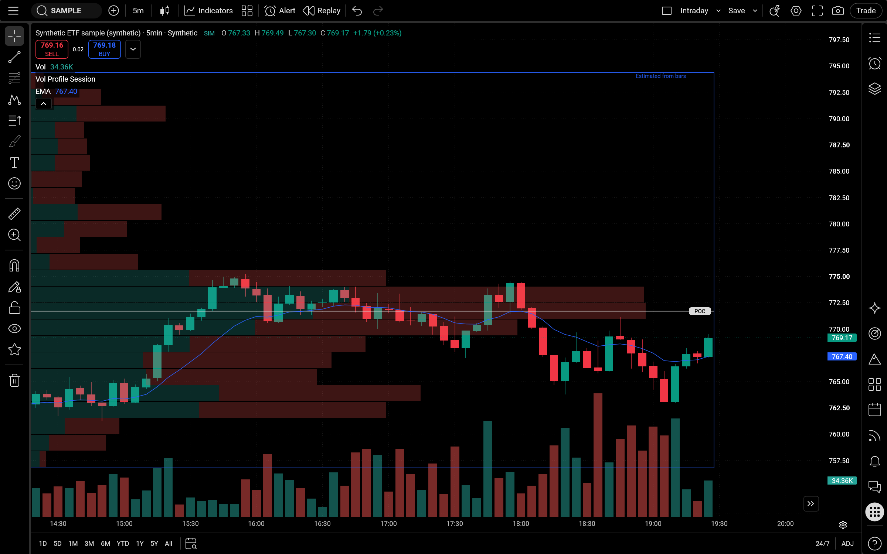
      </picture></a><br>
      Candles, a session volume profile, point of control and value area.
    </td>
  </tr>
  <tr>
    <td width="50%" valign="top">
      <strong>Plan an order</strong><br>
      <a href="docs/images/trading-dark.webp"><picture>
        <source media="(prefers-color-scheme: light)" srcset="docs/images/trading-light.webp">
        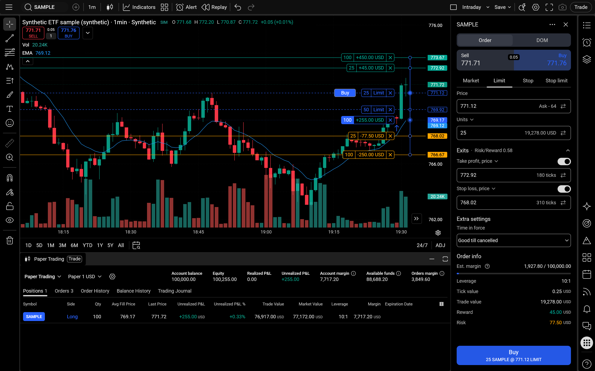
      </picture></a><br>
      Limit ticket with take profit, stop loss and risk/reward beside the paper account.
    </td>
    <td width="50%" valign="top">
      <strong>Work the ladder</strong><br>
      <a href="docs/images/depth-dark.webp"><picture>
        <source media="(prefers-color-scheme: light)" srcset="docs/images/depth-light.webp">
        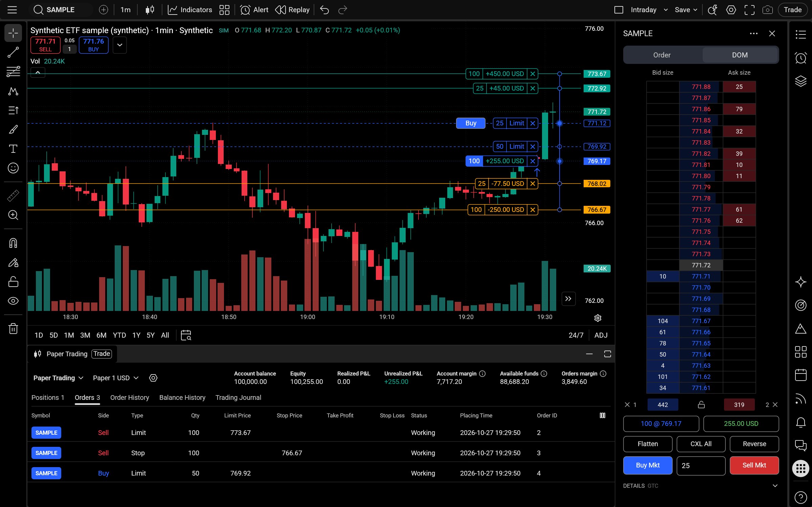
      </picture></a><br>
      Bid and ask sizes, bracket exits and working orders beside the paper account.
    </td>
  </tr>
  <tr>
    <td width="50%" valign="top">
      <strong>Read several intervals</strong><br>
      <a href="docs/images/layouts-dark.webp"><picture>
        <source media="(prefers-color-scheme: light)" srcset="docs/images/layouts-light.webp">
        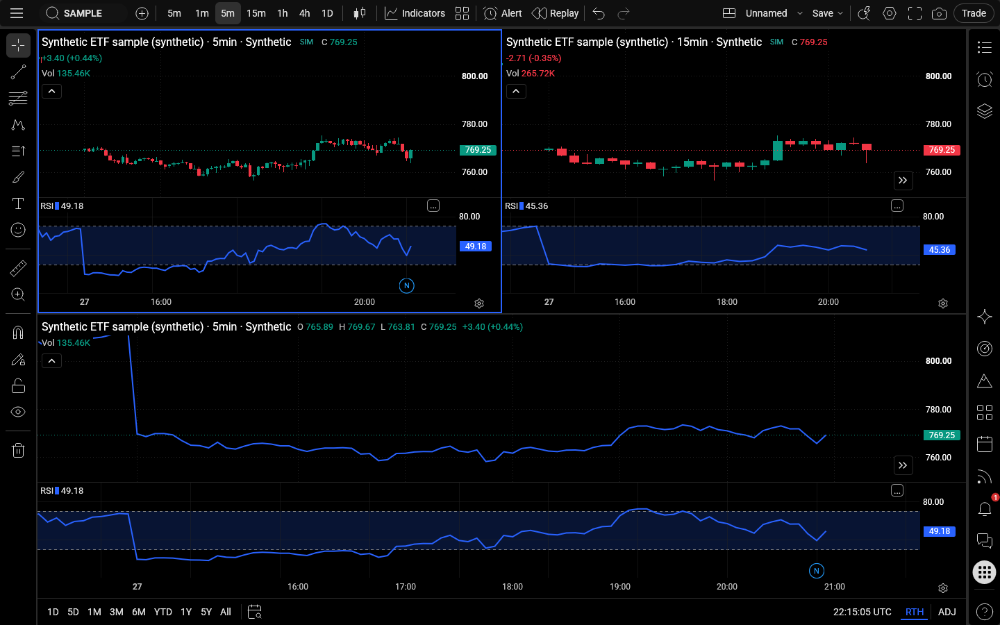
      </picture></a><br>
      Four linked charts with candles, Heikin-Ashi, OHLC bars and area.
    </td>
    <td width="50%" valign="top">
      <strong>Mark the setup</strong><br>
      <a href="docs/images/drawings-dark.webp"><picture>
        <source media="(prefers-color-scheme: light)" srcset="docs/images/drawings-light.webp">
        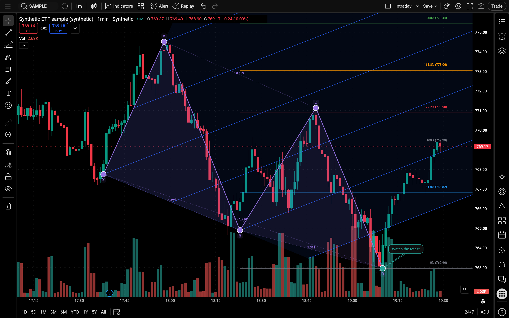
      </picture></a><br>
      Pitchfork, Fibonacci extension, XABCD pattern and a retest callout.
    </td>
  </tr>
  <tr>
    <td width="50%" valign="top">
      <strong>Choose studies</strong><br>
      <a href="docs/images/studies-dark.webp"><picture>
        <source media="(prefers-color-scheme: light)" srcset="docs/images/studies-light.webp">
        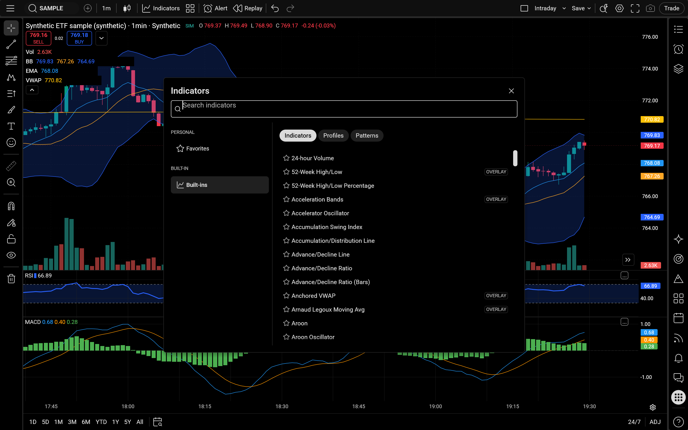
      </picture></a><br>
      The indicator catalog over Bollinger Bands, EMA, VWAP, RSI and MACD.
    </td>
    <td width="50%" valign="top">
      <strong>Rehearse the session</strong><br>
      <a href="docs/images/replay-dark.webp"><picture>
        <source media="(prefers-color-scheme: light)" srcset="docs/images/replay-light.webp">
        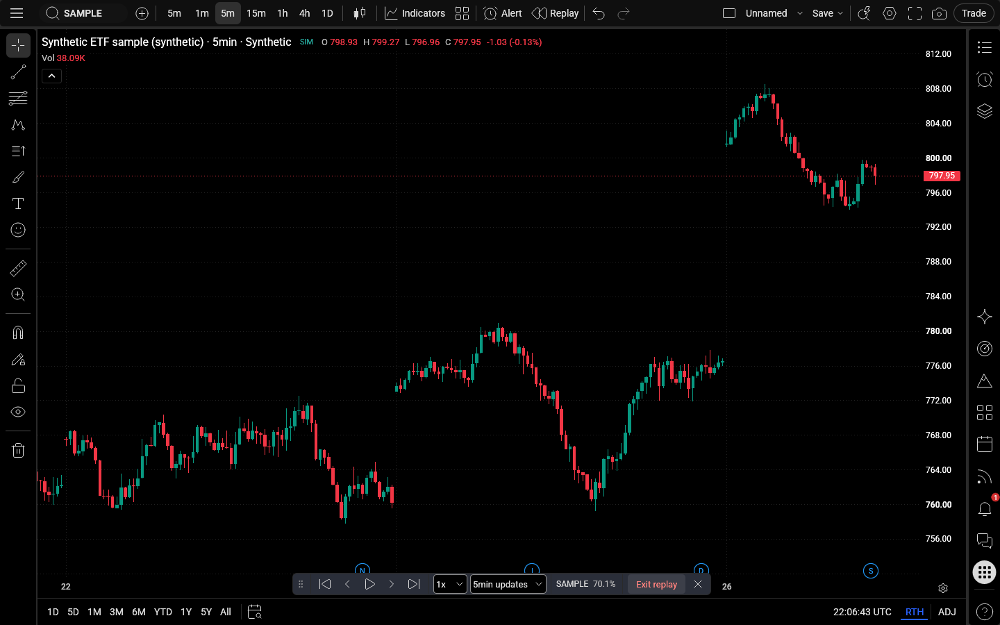
      </picture></a><br>
      Replay transport and a paper position with working orders.
    </td>
  </tr>
  <tr>
    <td width="50%" valign="top">
      <strong>Change the view</strong><br>
      <a href="docs/images/chart-types-dark.webp"><picture>
        <source media="(prefers-color-scheme: light)" srcset="docs/images/chart-types-light.webp">
        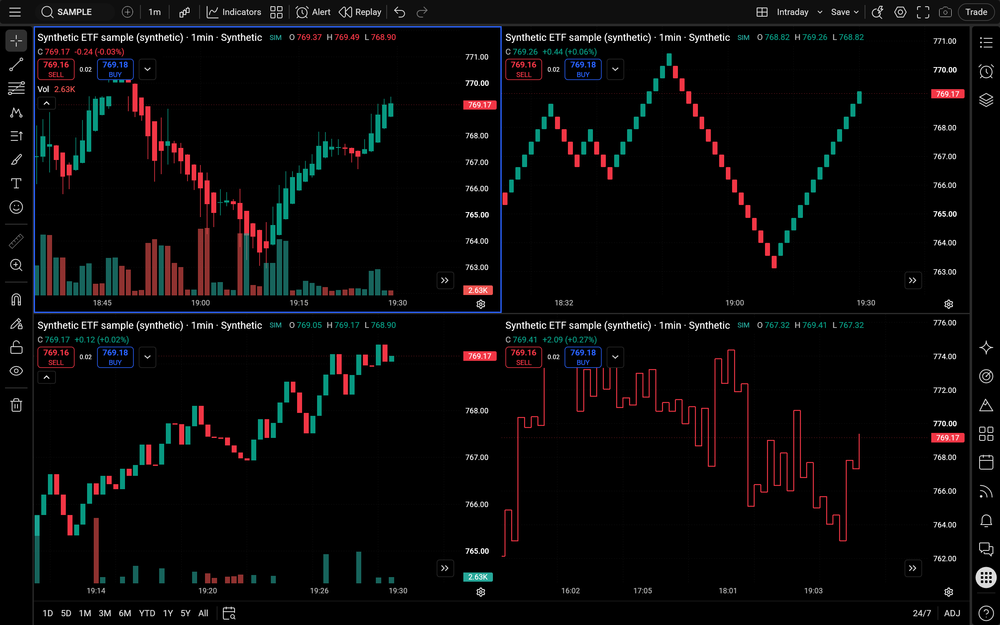
      </picture></a><br>
      Heikin-Ashi, Renko, range bars and Kagi in a four-chart layout.
    </td>
    <td width="50%" valign="top">
      <strong>Read the footprint</strong><br>
      <a href="docs/images/footprint-dark.webp"><picture>
        <source media="(prefers-color-scheme: light)" srcset="docs/images/footprint-light.webp">
        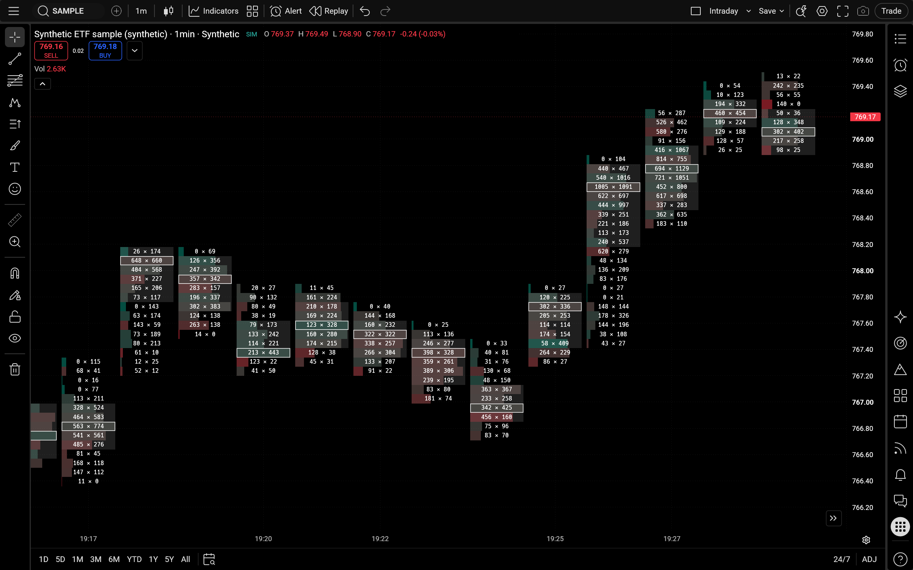
      </picture></a><br>
      Bid and ask volumes at each price level, from the sample feed’s trades.
    </td>
  </tr>
</table>

<p>
      <strong>Try a session</strong><br>
      <a href="https://userfrm.github.io/egui-charts/demo/">Open the live demo</a> to draw, add studies, switch layouts and trade the paper account.<br><br>
      Light and dark appearances follow your colour scheme. Open an image for the full view.
</p>

egui-charts draws price series, computes studies and handles chart interaction inside your egui application. Start with a `Chart`, or assemble a workspace from the toolbars, panels and dialogs. Your application supplies market data, broker connections and durable storage.

The [`terminal`](terminal) package assembles them on your `Datafeed` and performs their actions; each component also works on its own, as the [demo](examples/demo) shows.

## Status

[](https://userfrm.github.io/egui-charts/docs/progress/) [](https://userfrm.github.io/egui-charts/docs/progress/) [](https://userfrm.github.io/egui-charts/docs/progress/) [](https://userfrm.github.io/egui-charts/docs/progress/) [](https://userfrm.github.io/egui-charts/docs/progress/) [](https://userfrm.github.io/egui-charts/docs/progress/)

[](https://userfrm.github.io/egui-charts/docs/progress/)

## Start with a chart

Requires Rust 1.95 or newer. Use egui and eframe 0.37 throughout your application so their types match.

```toml
[dependencies]
egui-charts = "0.3"
eframe = "0.37"
```

```rust,no_run
use eframe::egui;
use egui_charts::{Chart, model::{Bar, BarData}};

fn main() -> eframe::Result {
    let bars = vec![
        Bar::new("2026-10-27T18:00:00Z".parse().unwrap(),
                 100.0, 102.0, 99.0, 101.0, 1_000.0),
        Bar::new("2026-10-27T18:01:00Z".parse().unwrap(),
                 101.0, 103.0, 100.0, 102.0, 1_200.0),
    ];
    let mut chart = Chart::new(BarData::from_bars(bars));
    eframe::run_ui_native("Price chart", Default::default(), move |ui, _| {
        egui::CentralPanel::default().show(ui, |ui| chart.show(ui));
    })
}
```

The widget handles pan, zoom and crosshair interaction. Use `chart.set_data(SeriesId::MAIN, bars)` to load history and `chart.update(SeriesId::MAIN, bar)` to merge a bar by its opening time. `SeriesId` is in `egui_charts::widget`.

Run the demo locally with:

```sh
cargo run --manifest-path examples/demo/Cargo.toml
```

## Bring your data

For a feed-backed chart, implement `Datafeed` and pass it to `ChartBuilder::with_feed`. Only `history` is required. The chart requests older pages as the user scrolls back; `subscribe` supplies live updates through a `Sink`.

Feed methods run on the UI thread and must return promptly. Fetch data elsewhere and answer through `Reply`, or respond inline when the data is already in memory. [`live_feed.rs`](examples/live_feed.rs) demonstrates paged history and a cancellable stream of sample trades. [`network_feed.rs`](examples/network_feed.rs) loads them from a local HTTP server, natively and in the browser.

| Your application supplies | The library consumes it through |
|---|---|
| Historical bars, live bars, trades and depth | `Datafeed` |
| Instrument search results | `SymbolSearch` |
| Orders, positions and account events | `Broker` |
| Saved drawings, layouts and settings | `Storage` |
| Alert rules and alert events | `Alerts` |

Order flow uses executions and depth from your feed. The library renders footprints, session volume profiles, volume bubbles and liquidity heatmaps. Footprints need a time-based interval and an instrument tick size; without them, or before retained executions begin, that chart style draws candles. OHLCV bars alone do not supply the aggressor side of trades.

The host also owns strategy execution and any scripting runtime. The [builder guide](docs/builder-guide.md) covers these integration points and the service contracts.

## Studies on the chart

Overlays share the price pane; oscillators get their own panes. The chart updates studies when its bars change. Built-in studies include moving averages, Bollinger Bands, RSI, MACD, Ichimoku and VWAP. Implement `Indicator` to supply your own calculation.

```rust
use egui_charts::studies::{BollingerBands, RSI};
fn add_studies(chart: &mut egui_charts::Chart) {
    chart.add_indicator(Box::new(BollingerBands::new(20, 2.0)));
    chart.add_indicator(Box::new(RSI::new(14)));
}
```

## Draw on price and time

Add trend lines, channels, Fibonacci drawings, shapes and annotations. `DrawingToolType` lists 98 drawing tool types, including cursor modes. The chart retains drawing timestamps through pan, zoom and interval changes, with undo and redo for edits. `Chart::save_drawings` returns a `DrawingStorage`; call its `to_json` method to serialize it for your storage.

## Build a workspace

The [`terminal`](terminal) package assembles the toolbars, menus and charts on your `Datafeed` and performs their actions, as an application on top of the library. Each component also works on its own: it returns an action for your app to apply, as the [demo](examples/demo) does. The library does not connect to a market data provider.

`ChartLayout` arranges charts in grids or tabs and can synchronize symbols, intervals, crosshairs, time ranges and drawings.

Choose a chart style with `Chart::set_chart_type`: candles, OHLC bars, line, area, baseline, Heikin-Ashi, Renko, Kagi, line break, point and figure, or range bars. See [`ChartType`](https://docs.rs/egui-charts/latest/egui_charts/model/enum.ChartType.html) for the full set.

The UI components also include replay controls, an order ticket, a depth ladder and an account panel. Connect trading UI to your `Broker` implementation; the demo uses `PaperAccount` for simulated execution.

## Fit your application

The default build includes the chart, studies, drawings and UI components, plus locale and named time zone support. Select a smaller build with `default-features = false`:

| Features | Included |
|---|---|
| `widget` | Chart widget and the `Indicator` extension point |
| `widget`, `studies` | Chart widget and built-in studies |
| `widget`, `drawings` | Chart widget and drawing interaction |
| `studies` | Study calculations without egui |
| `alert-engine` | `AlertEngine`, an alerts service that evaluates alerts on the bars the host feeds it, without egui |
| `detectors` | `OrderFlowDetectors`, a signals service that finds order-flow events in the trades and depth the host feeds it, without egui |
| `strategies` | `Backtest`, which runs a `Strategy` over bars and returns a `StrategyReport`, without egui |
| None | Data types, scales and host service contracts without egui |

For example:

```toml
egui-charts = { version = "0.3", default-features = false, features = ["widget", "studies"] }
```

`Theme::dark()`, `Theme::light()` and `Theme::high_contrast()` provide starting palettes. A `Theme` exposes its UI colours, chart colours, typography, spacing and corner radii as public fields. Apply it at startup and after a theme change:

```rust
use eframe::egui::Color32;
use egui_charts::theme::{Theme, apply_to_egui};

fn apply_theme(ctx: &eframe::egui::Context) {
    let mut theme = Theme::dark().with_accent(Color32::from_rgb(70, 120, 240));
    theme.chart.candle_up = Color32::from_rgb(0, 160, 120);
    apply_to_egui(ctx, &theme);
}
```

## Development and license

[ROADMAP.md](ROADMAP.md) tracks implemented work and remaining tasks. For contributions, start with [CONTRIBUTING.md](CONTRIBUTING.md) and the [Code of Conduct](CODE_OF_CONDUCT.md). Report security issues through the [Security Policy](SECURITY.md); use [Discussions](https://github.com/userFRM/egui-charts/discussions) for questions.

Licensed under [MIT](LICENSE-MIT) or [Apache-2.0](LICENSE-APACHE), at your option, for open source and commercial use. Bundled assets retain their own licenses; see [THIRD-PARTY-NOTICES.md](THIRD-PARTY-NOTICES.md).

To support development, use the repository's Sponsor button. Feature requests and bug reports belong in the [issue tracker](https://github.com/userFRM/egui-charts/issues).

Unless you explicitly state otherwise, any contribution intentionally submitted for inclusion in the work by you, as defined in the Apache-2.0 license, shall be dual licensed as above, without any additional terms or conditions.
