<div align="center">

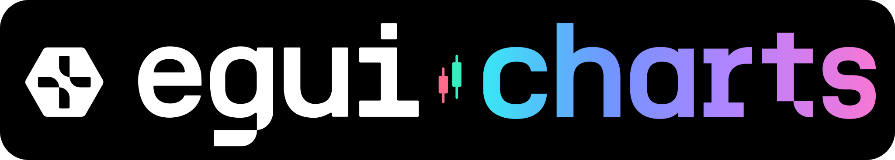

Financial charts for [egui](https://github.com/emilk/egui), from a single chart widget to a full trading terminal.

**[Live demo](https://userfrm.github.io/egui-charts/demo/)** · [Guide](https://userfrm.github.io/egui-charts/docs/) · [API docs](https://docs.rs/egui-charts) · [Examples](https://github.com/userFRM/egui-charts/tree/main/examples)

[](https://github.com/userFRM/egui-charts/actions)
[](https://crates.io/crates/egui-charts)
[](https://docs.rs/egui-charts)
[](#license)

</div>

<picture>
  <source media="(prefers-color-scheme: dark)" srcset="docs/images/hero-dark.webp">
  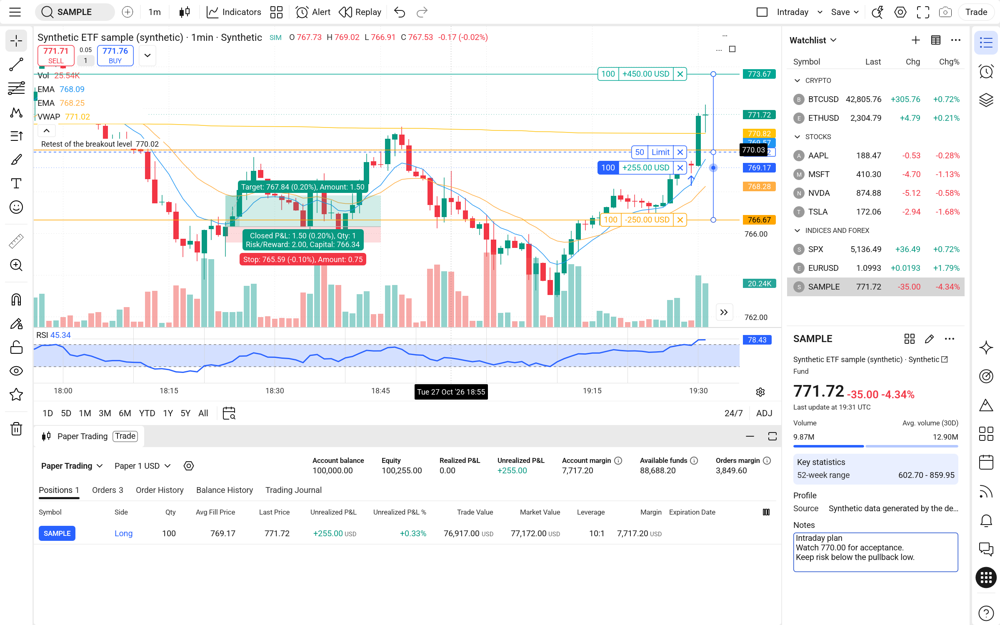
</picture>

The demo runs on generated sample data, natively and in the browser. Every image on this page is a capture of it.

## Status

[](https://userfrm.github.io/egui-charts/docs/progress/) [](https://userfrm.github.io/egui-charts/docs/progress/) [](https://userfrm.github.io/egui-charts/docs/progress/) [](https://userfrm.github.io/egui-charts/docs/progress/) [](https://userfrm.github.io/egui-charts/docs/progress/) [](https://userfrm.github.io/egui-charts/docs/progress/)

[](https://userfrm.github.io/egui-charts/docs/progress/)

## Quick start

The chart widget on its own, without toolbars or built-in studies:

```toml
[dependencies]
egui-charts = { version = "0.3", default-features = false, features = ["widget"] }
eframe = "0.37"
```

```rust,no_run
use eframe::egui;
use egui_charts::{Chart, model::{Bar, BarData}};

fn main() -> eframe::Result {
    let bars = vec![
        Bar::new("2024-01-01T00:00:00Z".parse().unwrap(),
                 100.0, 102.0, 99.0, 101.0, 1_000.0),
        Bar::new("2024-01-01T00:01:00Z".parse().unwrap(),
                 101.0, 103.0, 100.0, 102.0, 1_200.0),
    ];
    let mut chart = Chart::new(BarData::from_bars(bars));
    eframe::run_ui_native("My chart", Default::default(), move |ui, _| {
        egui::CentralPanel::default().show(ui, |ui| chart.show(ui));
    })
}
```

That chart pans, zooms and draws a crosshair. `set_data` replaces its bars and `update` merges a live one. Use eframe 0.37: another version pulls in a second egui whose types do not match.

`cargo add egui-charts` without the feature list gives the default build, with the studies, drawing tools, toolbars, panels and dialogs. To run the demo locally:

```sh
cargo run --manifest-path examples/demo/Cargo.toml
```

## Status

[](https://userfrm.github.io/egui-charts/docs/progress/) [](https://userfrm.github.io/egui-charts/docs/progress/) [](https://userfrm.github.io/egui-charts/docs/progress/) [](https://userfrm.github.io/egui-charts/docs/progress/) [](https://userfrm.github.io/egui-charts/docs/progress/) [](https://userfrm.github.io/egui-charts/docs/progress/)

[](https://userfrm.github.io/egui-charts/docs/progress/)

## Chart types

Candles, bars, hollow and volume candles, line, step line, area, baseline and columns. Heikin-Ashi, Renko, Kagi, line break, point and figure and range bars are built from the same bars. Switch with `set_chart_type`, or let the user pick from the toolbar menu.

<picture>
  <source media="(prefers-color-scheme: dark)" srcset="docs/images/chart-types-dark.webp">
  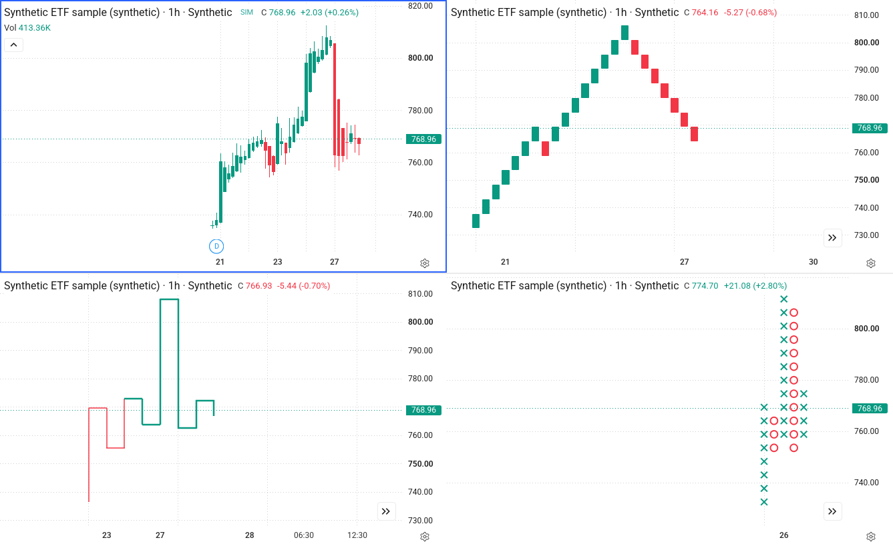
</picture>

## Studies

Moving averages, RSI, MACD, Bollinger Bands, Ichimoku, SuperTrend, VWAP, pivots and many more. Overlays sit on the price pane and oscillators get a pane of their own. The chart recomputes them as bars arrive.

```rust
use egui_charts::studies::{BollingerBands, RSI};
# let mut chart = egui_charts::Chart::new(egui_charts::model::BarData::default());
chart.add_indicator(Box::new(BollingerBands::new(20, 2.0)));
chart.add_indicator(Box::new(RSI::new(14)));
```

Your own study implements the `Indicator` trait and shows up in the indicator dialog next to the built-in ones.

<picture>
  <source media="(prefers-color-scheme: dark)" srcset="docs/images/studies-dark.webp">
  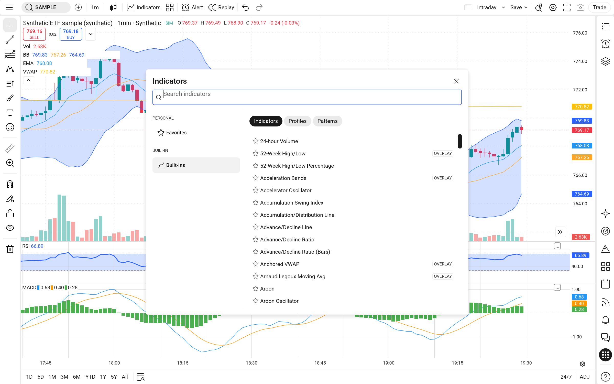
</picture>

## Drawing tools

Trend lines, channels, Fibonacci tools, patterns, projections, shapes, text and icons. Drawings are anchored to time and price, so they stay put when you pan or change the interval. The magnet snaps anchors to OHLC values. Undo and redo are built in, and `Chart::save_drawings` writes them to JSON.

<picture>
  <source media="(prefers-color-scheme: dark)" srcset="docs/images/drawings-dark.webp">
  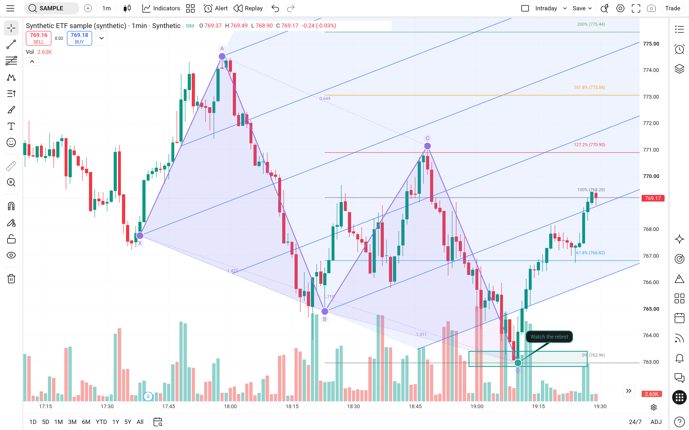
</picture>

## Order flow

Feed executions and depth updates through your `Datafeed` and the chart draws footprints, volume profiles, Market Profile (TPO), volume bubbles and a heatmap of the order book over time. The picture shows a footprint and volume bubbles built from the sample trades. Order flow needs real trades: the library does not guess the aggressor side from bars.

<picture>
  <source media="(prefers-color-scheme: dark)" srcset="docs/images/order-flow-dark.webp">
  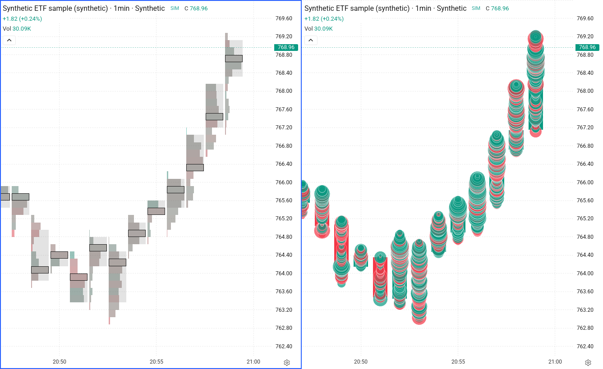
</picture>

## Trading from the chart

Implement the `Broker` trait and the chart gets buy and sell buttons, an order ticket with a depth ladder (the DOM tab), draggable order and position lines, and an account panel with positions, orders and history. The demo connects a paper account that fills against the sample prices.

<picture>
  <source media="(prefers-color-scheme: dark)" srcset="docs/images/trading-dark.webp">
  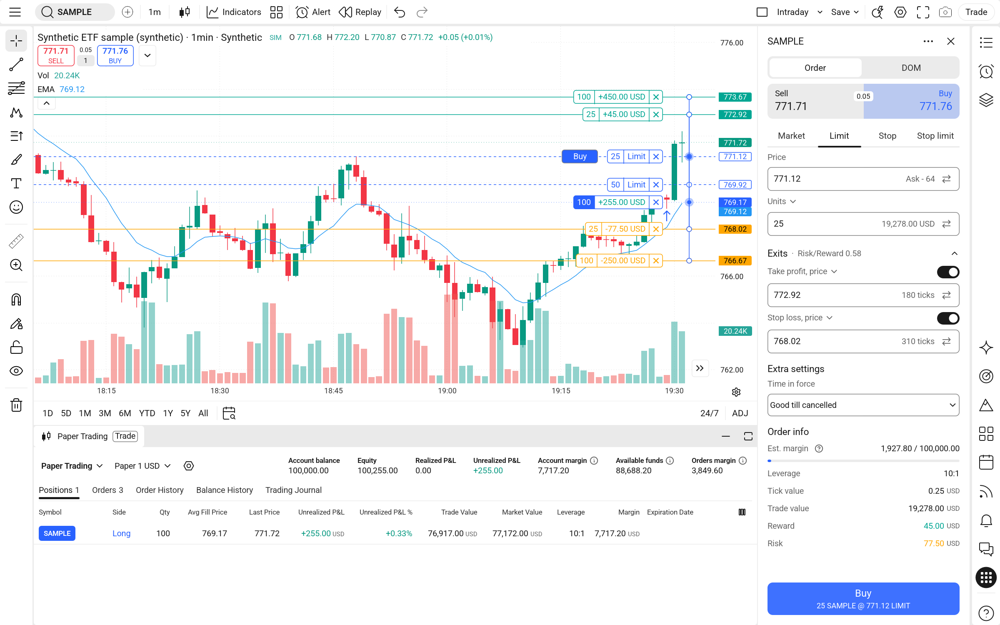
</picture>

## Multi-chart layouts

Up to sixteen charts in a grid, or tabs. Charts in a layout can share the symbol, interval, crosshair, time range and drawings. Layouts save and load through your storage.

<picture>
  <source media="(prefers-color-scheme: dark)" srcset="docs/images/layouts-dark.webp">
  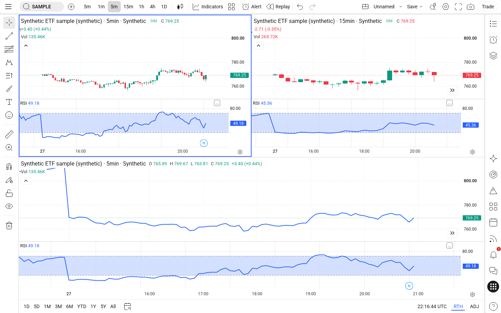
</picture>

## Replay

Pick a bar and play the history forward from there, bar by bar or at a chosen speed. Studies and drawings follow along, and the paper account can trade during replay.

<picture>
  <source media="(prefers-color-scheme: dark)" srcset="docs/images/replay-dark.webp">
  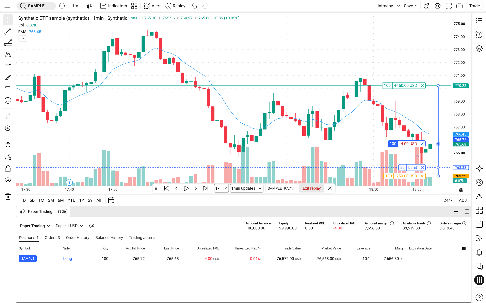
</picture>

## Themes

Dark, light and high-contrast presets. A `Theme` is a plain struct: start from a preset, change the colours you care about and apply it.

```rust
use eframe::egui::Color32;
use egui_charts::theme::{Theme, apply_to_egui};

# let ctx = &eframe::egui::Context::default();
let mut theme = Theme::dark().with_accent(Color32::from_rgb(255, 120, 0));
theme.chart.candle_up = Color32::from_rgb(0, 160, 120);
apply_to_egui(ctx, &theme);
```

| Dark | Light |
|---|---|
| 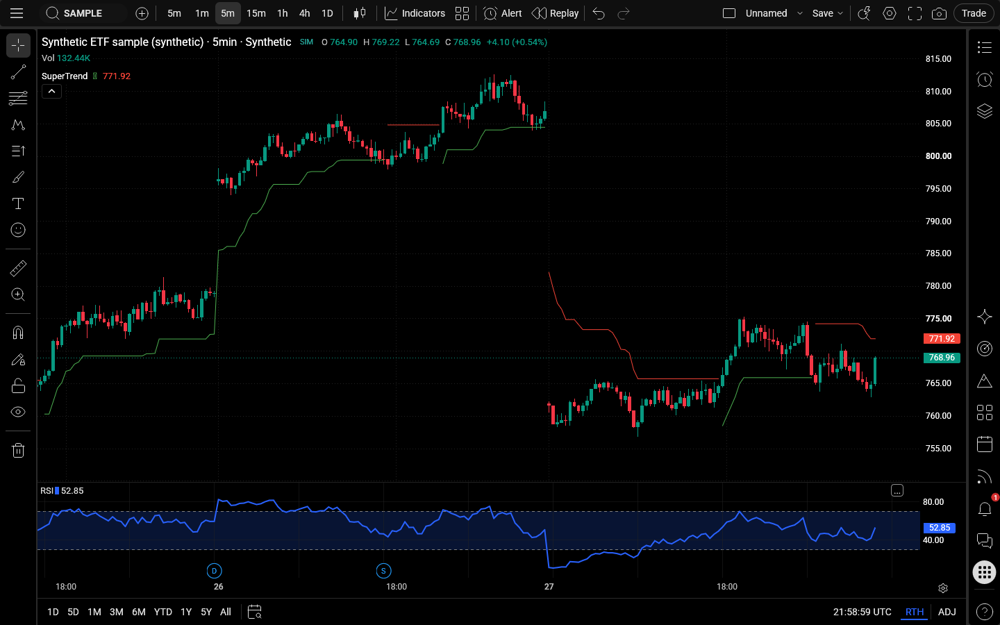 | 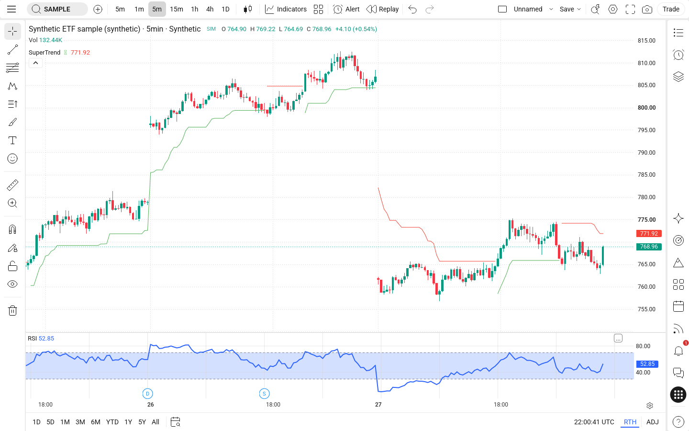 |

## Bring your own data

The library has no market data, accounts or storage of its own. It defines traits and you implement the ones you need: `Datafeed` for bars, trades and depth, `SymbolSearch`, `Broker`, `Storage`, `Alerts`, `Signals`, `Quotes`, `Marks`, `Notifications` and a few more in [`services`](https://docs.rs/egui-charts/latest/egui_charts/services/). Each one is small and every method but the core one has a default.

`Datafeed` needs only `history`. The chart calls it on the UI thread and never waits: answer through the `Reply` from any thread or task.

```rust
use egui_charts::data::{Datafeed, HistoryPage, HistoryRequest, Reply, Subscription};

struct MyFeed;

impl Datafeed for MyFeed {
    fn history(&self, request: HistoryRequest, reply: Reply<HistoryPage>) {
        std::thread::spawn(move || {
            // Load up to `request.count` bars that open before `request.before`.
            let _ = request;
            reply.send(Ok(HistoryPage::default()));
        });
    }

    fn subscribe(&self, subscription: Subscription) {
        // Push live bars with `subscription.sink.push_bar(bar)` until `sink.is_active()` is false.
        let _ = subscription;
    }
}
```

Hand it to `ChartBuilder::with_feed` or `Chart::set_feed`. The chart asks for older pages as the user scrolls back. [`examples/live_feed.rs`](examples/live_feed.rs) streams synthetic trades, and the [builder guide](https://userfrm.github.io/egui-charts/docs/) covers the rest.

Today you place the toolbars, panels and dialogs in your own egui layout and apply the actions they return, as [the demo](examples/demo) does. A terminal component that does this wiring for you is in progress ([#205](https://github.com/userFRM/egui-charts/issues/205)).

## Roadmap

[ROADMAP.md](ROADMAP.md) lists what works and what is left, area by area. Open work is grouped in the [milestones](https://github.com/userFRM/egui-charts/milestones).

## Sponsoring and using it in a product

egui-charts is free under MIT or Apache-2.0, in open source and commercial products alike. If it saves you work, the Sponsor button at the top of the repository funds its development. Building a product on it and need a feature or a fix? Open an issue in the [tracker](https://github.com/userFRM/egui-charts/issues).

## License

Licensed under either of [Apache License, Version 2.0](LICENSE-APACHE) or [MIT License](LICENSE-MIT) at your option. Bundled icons and the Roboto font keep their own licences; see [THIRD-PARTY-NOTICES.md](THIRD-PARTY-NOTICES.md).

The minimum supported Rust version is 1.95 (edition 2024).

## Contributing

Bug reports, fixes, studies, drawing tools, chart types and themes are welcome. [CONTRIBUTING.md](CONTRIBUTING.md) covers the setup, where each kind of addition goes and the checks CI runs. Please read the [Code of Conduct](CODE_OF_CONDUCT.md) and report security issues as described in the [Security Policy](SECURITY.md). Questions go to [Discussions](https://github.com/userFRM/egui-charts/discussions).

Unless you explicitly state otherwise, any contribution intentionally submitted for inclusion in the work by you, as defined in the Apache-2.0 license, shall be dual licensed as above, without any additional terms or conditions.
